


 



  


<a href="https://github.com/PADSViduranga?tab=repositories"></a>

<a href="https://github.com/PADSViduranga?tab=repositories"></a>

<a href="https://github.com/PADSViduranga?tab=repositories"></a>

<a href="https://github.com/PADSViduranga?tab=repositories"></a>

<table>
<tr>
<td width="50%" valign="top"><a href="https://github.com/PADSViduranga?tab=repositories"></a></td>
<td width="50%" valign="top"><a href="https://github.com/PADSViduranga?tab=repositories"></a></td>
</tr>
</table>

 



  

<table>
<tr>
<td align="center" width="25%">
<b>LANGUAGES</b>  

</td>
<td align="center" width="25%">
<b>FRAMEWORKS</b>  

</td>
<td align="center" width="25%">
<b>DATABASES</b>  

</td>
<td align="center" width="25%">
<b>TOOLS &amp; CLOUD</b>  

</td>
</tr>
</table>

  



  


 


  


